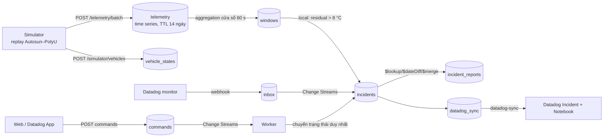

# Kiến trúc dữ liệu và mô hình MongoDB

Cập nhật 28/10/2026, theo code trên `main` và dữ liệu thật của MongoDB 8.0.5 (replica set một node) đang chạy. Định nghĩa collection và index nằm ở `chargeops/storage.py:initialize`; hợp đồng trường telemetry ở [CONTRACT.md §1](CONTRACT.md).

## 1. Vì sao MongoDB là nền tảng dữ liệu vận hành chính

Mọi trạng thái của ChargeOps nằm trong MongoDB: telemetry, cửa sổ bằng chứng, sự cố, lệnh vận hành, webhook inbox, run demo, phiên đăng nhập, báo cáo hậu kiểm và trạng thái đồng bộ Datadog. Datadog chỉ nhận bản sao tín hiệu để quan sát và cảnh báo; nếu mất Datadog, dữ liệu và lệnh vẫn còn trong MongoDB (CONTRACT §4).

| Nhu cầu | Tính năng MongoDB dùng |
|---|---|
| Telemetry 5 giây × 6 connector, đọc theo khoảng thời gian | Time Series Collection (`timeField: measured_at`, `metaField: meta`, `granularity: seconds`) |
| Dữ liệu thô không giữ mãi, bằng chứng sự cố thì giữ | `expireAfterSeconds: 1209600` (14 ngày) trên telemetry; bằng chứng được chép vào `incidents`/`windows` ngoài TTL |
| Phát hiện bất thường từ dữ liệu thô | Aggregation Pipeline: khử trùng mẫu, tính residual theo cửa sổ 60 giây |
| Xu hướng residual cho kỹ sư | `$setWindowFields` (trung bình 5 phút, đạo hàm 2 phút, max 15 phút) |
| Tổng hợp MTTA/MTTM/MTTR | `$facet` trong một lần aggregation |
| Báo cáo hậu kiểm | `$lookup` + `$dateDiff` + `$merge` vào `incident_reports` |
| Worker phản ứng theo sự kiện, không mất việc khi restart | Change Streams có resume token lưu bền vững |
| Một sự cố mở duy nhất mỗi connector, lệnh không chạy hai lần | Unique partial index, unique index cho idempotency key |
| Phiên đăng nhập hết hạn | TTL index `expireAfterSeconds: 0` trên `sessions.expires_at` |

## 2. Sơ đồ luồng dữ liệu

## 3. Collection

Số document là ảnh chụp ngày 28/10/2026 trên máy demo, sau 17 run (10 run Datadog).

| Collection | Vai trò | Trường chính | Index / ràng buộc | Ai ghi |
|---|---|---|---|---|
| `telemetry` (time series) | Mẫu đo 5 giây | `measured_at`, `meta{run_id, station_id, charger_id, connector_id}`, `sample_id`, `voltage_v`, `current_a`, `power_kw`, `requested_current_a`, `current_limit_a`, `connector_temperature_c`, `ambient_temperature_c`, `provenance{composition, manifest_id}`, `received_at` | `(meta.run_id, measured_at)`, `(meta.run_id, meta.connector_id, measured_at)`; TTL 14 ngày | API (`/telemetry/batch`) |
| `windows` | Bằng chứng mỗi cửa sổ 60 giây | `_id = run:connector:end`, `start`, `end`, `count`, `quality`, `residual_mean`, `samples[]` | `_id` tất định chống ghi trùng; `(run_id, connector_id, end -1)` | Worker |
| `incidents` | Vòng đời sự cố | `kind`, `state`, `state_since`, `unresolved`, `cycle`, `source: local|datadog`, `evidence`, `evidence_before/after`, `original_limit_a`, `reference_current_a`, `target_current_a`, `timeline[{at, event, reason}]`, các mốc `opened_at … resolved_at` | **Unique partial** `(run_id, connector_id, kind)` khi `unresolved: true` | Chỉ worker |
| `commands` | Lệnh vận hành | `idempotency_key`, `incident_id`, `type`, `actor: operator|datadog-app`, `status`, `validated`, `created_at`, `applied_at` | **Unique** `idempotency_key`; `(incident_id, type, applied_at -1)` | API tạo, worker/simulator cập nhật |
| `inbox` | Webhook Datadog bền vững | `event_id`, `monitor_id`, `run_id`, `connector_id`, `occurred_at`, `status: alert|recovery`, `processed`, `outcome` | `_id` = event id chống lặp; `(processed, occurred_at)` | API ghi trước khi trả 202, worker xử lý |
| `runs` | Run demo / đánh giá | `mode: local|datadog`, `scenario`, `seed`, `profile_id`, `status`, `baseline_version`, `sim{…}`, `start_requested_at`, `started_at`, `stopped_at` | **Unique partial** `active_slot` = chỉ một run hoạt động | API, worker |
| `run_events` | Sự kiện điều khiển simulator (inject-fault) | `run_id`, `requested_at`, `consumed_at` | `(run_id, consumed_at, requested_at)` | API, simulator |
| `vehicle_states` | SoC xe mới nhất mỗi connector | `_id = run:connector`, `soc_percent`, `energy_kwh`, `minutes_to_full`, `capacity_source` | `run_id` | API (upsert) |
| `monitor_state` | Trạng thái monitor đã xử lý | `_id`, `occurred_at`, `status` | — | Worker (bỏ webhook cũ hơn trạng thái đã biết) |
| `budgets` | Trần 20 run Datadog mỗi trial | `_id = trial`, `run_ids[]` | — | API khi start run Datadog |
| `incident_reports` | Hậu kiểm mỗi sự cố đã đóng | `closed_by`, `seconds_to_ack`, `seconds_to_effective_reduction`, `seconds_to_mitigated`, `seconds_to_resolved`, `peak_residual_c`, `energy_kwh_while_derated`, `simulated: true` | `_id` = incident id (`$merge`) | Pipeline hậu kiểm |
| `datadog_sync` | Trạng thái đồng bộ sang Datadog Incidents/Notebooks | `dd_incident_id`, `synced_events`, `timeline_attempted`, `notebook_id`, `notebook_attached`, `dd_resolved`, `postmortem_*`, `attempts`, `next_attempt_at` | `_id` = incident id | `datadog-sync` (không bao giờ ghi `incidents`) |
| `dd_event_cursor` | Số event timeline đã gửi lên Datadog Events | `sent` | `_id` = incident id | Worker |
| `worker_state` | Resume token của Change Stream | `token` | `_id = change_stream` | Worker |
| `sessions` | Phiên operator | `username`, `created_at`, `expires_at` | TTL `expires_at` | API |
| `sources` | Manifest nguồn dữ liệu theo từng trường | `composition: hybrid`, `fields{…: public|synthetic|derived}`, `source{doi, license, authors}` | `_id` = manifest id | API khi khởi tạo |

## 4. Aggregation Pipeline gắn với bài toán

| Pipeline | File | Mục đích vận hành |
|---|---|---|
| Cửa sổ telemetry | `chargeops/storage.py:telemetry_pipeline`, `fleet_window_rows` | Lọc theo run/connector/khoảng thời gian, khử trùng theo `sample_id` (mẫu trùng và mẫu đến muộn không làm sai kết quả), sắp theo `measured_at`; một aggregation cho cả 6 connector mỗi vòng worker |
| Residual nhiệt | `chargeops/domain.py:with_residuals`, `window_evidence` | Nhiệt kỳ vọng = nhiệt môi trường + k·I² có quán tính τ; residual = đo − kỳ vọng; cửa sổ 60 giây chỉ hợp lệ khi ≥10 mẫu, đủ 4 block 15 giây, không hở >15 giây, mẫu cuối ≤30 giây |
| Latest state / màn hình trạm | `chargeops/api.py:connector_views` (`/connectors`, `/stations/{id}`) | `$sort` theo `measured_at` rồi `$group … $first`: trạng thái mới nhất theo thời gian đo, mẫu cũ đến muộn không ghi đè |
| Xu hướng residual | `chargeops/insights.py:trend_pipeline` | `$setWindowFields`: trung bình 5 phút, độ dốc °C/phút, max 15 phút trên cửa sổ hợp lệ |
| Toàn cảnh fleet | `chargeops/insights.py:fleet_pipeline` | Cửa sổ mới nhất mỗi connector; `$project` trước `$sort` để không sắp mảng `samples` |
| Tổng hợp sự cố | `chargeops/insights.py:incident_summary_pipeline` | `$facet`: số sự cố theo trạng thái/connector, MTTA, MTTM (tới giảm tải đã xác minh), MTTR |
| Hậu kiểm | `chargeops/postmortem.py:postmortem_pipeline` | `$lookup` windows và telemetry, `$dateDiff` các mốc, năng lượng khi giảm tải, `$merge` vào `incident_reports` |

`python -m chargeops.check_mongo` chạy các pipeline cần MongoDB thật (time series, `$setWindowFields`, `$merge`) vì mongomock không hỗ trợ chúng.

## 5. Bảo đảm nhất quán

- **Một writer cho trạng thái sự cố:** API chỉ ghi yêu cầu (`commands`, `inbox`, `run_events`); worker là nơi duy nhất chuyển trạng thái `incidents`, cập nhật có điều kiện theo `state`.
- **Không mở trùng sự cố:** unique partial index `(run_id, connector_id, kind)` khi `unresolved: true`.
- **Lệnh idempotent:** cùng `Idempotency-Key` và payload trả lại lệnh cũ; khác payload trả 409.
- **Webhook at-least-once:** inbox ghi bền vững trước khi trả 202; `_id` là event id nên gửi lại trả `duplicate`.
- **Không mất việc khi restart:** resume token lưu trong `worker_state`; token hỏng hoặc MongoDB mất kết nối thì mở lại stream (backoff tới 30 giây), còn vòng tick định kỳ của worker vẫn quét inbox/commands chưa xử lý nên không bỏ sót việc.
- **Đồng bộ Datadog không làm hỏng dữ liệu gốc:** `datadog-sync` chỉ đọc `incidents` và ghi `datadog_sync`; mỗi POST có cờ "đã thử" để lỗi mơ hồ (timeout, 5xx) không tạo bản ghi trùng trên Datadog.

## 6. Giới hạn hiện tại

- MongoDB chạy local một node replica set (đủ cho Change Streams), không dùng Atlas; không dùng Atlas Search, Vector Search hay geospatial.
- `run_id` là khái niệm demo; hướng mở rộng nhiều site ở [ARCHITECTURE.md §3–4](ARCHITECTURE.md).
- Nhiệt độ, lỗi và phản ứng sau lệnh là mô phỏng; chỉ đường tải lấy từ dataset công khai ([DATA_CARD.md](DATA_CARD.md)).
