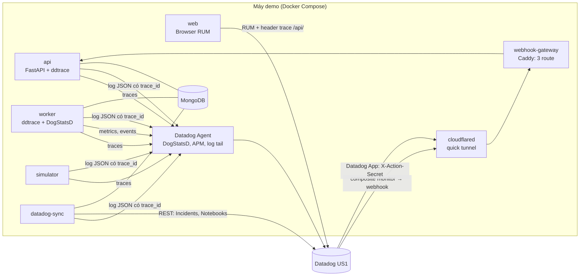

# Quan sát hệ thống (Datadog)

Tài liệu này mô tả các tín hiệu, dashboard, monitor và cách điều tra một sự cố nhiệt. Tất cả được tạo bởi `scripts/setup_datadog.py` (chạy lại là cập nhật tại chỗ theo id trong `artifacts/datadog-resources.json`).

## 0. Kiến trúc quan sát

| Lớp | Thành phần | Nối với lớp khác bằng |
|---|---|---|
| Metrics | DogStatsD từ worker: residual, mẫu, chất lượng cửa sổ, nhiệt/dòng, sự cố, heartbeat, SLO | Tag `run_id`, `connector_id`, `station_id`, `env:hackathon` |
| Logs | JSON một dòng từ mọi service, Agent đọc volume `app-logs` | `run_id`, `connector_id`, `incident_id`, `dd.trace_id` |
| APM | `ddtrace` cho FastAPI, vòng worker, request của simulator | `trace_id` trong log; header trace từ RUM |
| RUM | `@datadog/browser-rum` trên giao diện vận hành | `allowedTracingUrls` cho `/api/`, `trackResources: true` |
| Events | Mỗi bước timeline sự cố thành event `source:chargeops` | `aggregation_key = incident_id`, phủ lên biểu đồ dashboard |
| Phát hiện | Monitor thermal + quality → composite → webhook | Webhook mang `run_id`, `connector_id`, `monitor_id` |
| Phản ứng | Datadog App gọi route có `X-Action-Secret`; web gọi API bằng session | Cùng cổng trạng thái của worker; `actor` ghi trên command |
| Hậu kiểm | `datadog-sync`: Incident, todo cho từng bước, Notebook điều tra, postmortem | `_id` sự cố ChargeOps nằm trong tiêu đề Incident và tên Notebook |

## 1. Tín hiệu theo chế độ chạy

| Tín hiệu | Chế độ local | Chế độ `datadog` |
| --- | --- | --- |
| Log JSON (`service:chargeops`) | có | có |
| Metric telemetry (`chargeops.samples`, `residual_*`, `quality`, nhiệt, dòng sạc) | không | có |
| Metric sự cố `chargeops.incident.open`, `chargeops.incident.state_age_s` (tag `state:<trạng thái>`) | không | có |
| Event Datadog gắn tag `source:chargeops` (có thể mang `incident_id`) | không | có |
| Heartbeat `chargeops.worker.tick` | chỉ khi `DD_METRICS_ENABLED=true` | có nếu `DD_METRICS_ENABLED=true` |

`DD_METRICS_ENABLED` mặc định là `false`. Đặt `DD_METRICS_ENABLED=true` trong `.env` rồi tạo lại worker để bật heartbeat. Metric chỉ dùng tag `run_id`, `connector_id`, `station_id`, `env:hackathon` và `state:<trạng thái>` (riêng `state_age_s`); không có `incident_id` hay `session_id` trong tag metric.

## 2. Dashboard

### Kỹ sư điện / vận hành trạm

| Widget | Truy vấn | Trả lời câu hỏi |
| --- | --- | --- |
| Trạng thái cảnh báo | danh sách monitor `ChargeOps` | Monitor nào đang cảnh báo? |
| Residual trung bình theo connector | `(residual_positive - residual_negative) / samples` | Connector nào nóng bất thường nhất? |
| Residual nhiệt (°C, trung bình theo mẫu) | cùng công thức, vạch 8 °C và 3 °C, lớp phủ event `tags:source:chargeops` | Residual vượt ngưỡng lúc nào, sự cố mở/đóng lúc nào? |
| Nhiệt đo được và nhiệt kỳ vọng theo tải (°C) | `connector_temperature_c`, `expected_temperature_c` | Nhiệt thực tế lệch bao nhiêu so với kỳ vọng? |
| Dòng sạc và giới hạn dòng (A) | `current_a`, `current_limit_a`, lớp phủ event | Giảm tải đã được áp dụng chưa? |
| Nhiệt độ môi trường (°C) | `ambient_temperature_c` | Nhiệt độ cao do môi trường hay do thiết bị? |
| Sự cố đang mở theo connector | `sum:chargeops.incident.open by {connector_id}`, lớp phủ event | Connector nào đang có sự cố mở? |
| Thời gian ở trạng thái hiện tại (s) | `max:chargeops.incident.state_age_s by {connector_id,state}`, vạch 600 s | Sự cố kẹt ở một trạng thái bao lâu? |
| Webhook và lệnh vận hành | log `webhook_*`, `command_*` | Hệ thống đã gửi/áp dụng/từ chối lệnh nào? |

### IT / SRE nền tảng

| Widget | Truy vấn | Trả lời câu hỏi |
| --- | --- | --- |
| Trạng thái monitor | danh sách monitor | Monitor nào đang cảnh báo? |
| API: request, độ trễ p50/p95, nhóm mã HTTP | `trace.fastapi.request*` | API có khỏe không? |
| Simulator → API | `trace.http.request.hits.by_http_status` | Simulator gửi request có thành công không? |
| Worker: số vòng xử lý và độ trễ p95 | `trace.worker.tick*` | Worker có chạy đều không? |
| Mẫu telemetry nhận theo connector | `chargeops.samples` | Dữ liệu có đến đều không? |
| Chất lượng cửa sổ telemetry | `chargeops.quality` | Cửa sổ dữ liệu hợp lệ hay thiếu/cũ? |
| Log theo sự kiện | log `service:chargeops` nhóm theo `@event` | Hệ thống đang ghi nhận loại sự kiện nào? |
| Lỗi, retry và lệnh bị từ chối | log lỗi, `ingest_retry`, `worker_retry`, `command_rejected` | Có lỗi hoặc retry nào không? |
| Worker heartbeat (tick / phút) | `sum:chargeops.worker.tick{env:hackathon}.as_rate()` nhân 60 | Worker còn sống không? |

## 3. Monitor

| Monitor | Truy vấn | Ngưỡng | Webhook |
| --- | --- | --- | --- |
| `ChargeOps thermal residual` (thermal) | residual trung bình theo mẫu, `last_1m` | > 8 °C, phục hồi 3 °C | không |
| `ChargeOps valid telemetry window` (quality) | `min:chargeops.quality`, `last_1m` | > 0.5 | không |
| `ChargeOps thermal incident` (composite) | `thermal && quality` | cả hai cùng cảnh báo | **có** (`@webhook-chargeops-minimal`), duy nhất |
| `ChargeOps telemetry stale` (stale) | `sum:chargeops.samples` theo `run_id,connector_id`, `last_2m` | < 12 mẫu; `notify_no_data` tắt | không |
| `ChargeOps worker heartbeat` (worker) | `sum:chargeops.worker.tick`, `last_2m` | < 1; `notify_no_data` bật (4 phút) | không |
| `ChargeOps derating not resolving` (stuck) | `max:chargeops.incident.state_age_s{state:mitigating}`, `last_5m` | > 600 s | không |

Lưu ý: worker vẫn gửi `chargeops.samples = 0` khi một connector im lặng, nên monitor `stale` bắt được connector mất dữ liệu bằng điều kiện `< 12`; không có dữ liệu chỉ xảy ra khi run kết thúc (bình thường) hoặc worker chết (việc của monitor `worker`), nên `stale` không cảnh báo no-data. Monitor `worker` sẽ cảnh báo bất cứ khi nào `DD_METRICS_ENABLED=false`, vì khi đó không có heartbeat.

Chỉ monitor composite gọi webhook; các monitor còn lại chỉ có link điều tra trong nội dung cảnh báo.

### SLO

Hai SLO dạng metric, tạo bởi `scripts/setup_datadog.py` (trước các dashboard) và hiện thành widget SLO trên dashboard kỹ sư điện. Chỉ run chế độ `datadog` phát các metric này.

| SLO | Good / Total | Mục tiêu | Ý nghĩa |
|---|---|---|---|
| `ChargeOps effective derating within 5 min` | `chargeops.slo.mitigation.good` / `.total` (mỗi sự cố một lần, do `datadog-sync` phát khi báo cáo postmortem đã ghi) | 95 % (7 ngày, 30 ngày) | Sự cố được giảm tải hiệu quả (đã xác minh) trong 300 s kể từ khi mở. Sự cố đã giảm thiểu nhưng chưa xác minh giảm tải tính là không đạt. |
| `ChargeOps uninterrupted charging minutes` | `chargeops.slo.charging_minutes.good` / `.total` (0,25 phút mỗi block 15 s do worker phát) | 95 % (7 ngày, 30 ngày) | Trong số phút xe yêu cầu dòng sạc (`requested_current_a > 0`), tỷ lệ phút thực sự có dòng (`current_a > 0`). |

## 4. Lộ trình điều tra một sự cố

1. Monitor composite cảnh báo. Nội dung chứa link dashboard kỹ sư dự kiến lọc sẵn (chưa kiểm chứng) theo `run_id` và `connector_id` (template variable) và link Logs.
2. Mở dashboard kỹ sư: xem biểu đồ "Residual nhiệt" với vạch 8 °C / 3 °C và các event `source:chargeops` phủ lên để biết sự cố mở, giảm tải, phục hồi lúc nào.
3. Xem "Dòng sạc và giới hạn dòng": dòng có bị hạ xuống giới hạn mới sau lệnh giảm tải không.
4. Xem "Thời gian ở trạng thái hiện tại" và "Sự cố đang mở": sự cố có kẹt ở trạng thái giảm tải quá 600 s không (monitor `stuck`).
5. Xem log stream "Webhook và lệnh vận hành" để thấy lệnh đã gửi, được áp dụng hay bị từ chối.
6. Mở link Logs trong cảnh báo để lọc toàn bộ log của `run_id`.
7. Từ một dòng log, lấy `dd.trace_id` và mở trace APM tương ứng trên dashboard IT/SRE để xem độ trễ và lỗi của request hoặc vòng worker.

## 5. Browser RUM (giao diện vận hành)

RUM chỉ bật khi lúc build web có `DD_RUM_APPLICATION_ID` và `DD_RUM_CLIENT_TOKEN`; để trống thì RUM tắt hoàn toàn, không có dữ liệu giả.

1. Trên Datadog: UX Monitoring, RUM Applications, New Application, loại JavaScript. Chép `applicationId` và `clientToken` (token công khai, khác API key và App key).
2. Điền hai giá trị vào `.env` (`DD_SITE` phải đúng site tài khoản), rồi build lại web: `docker compose --profile observability up --build -d web`. Giá trị được ghi vào bundle lúc build, nên đổi giá trị phải build lại.
3. Dữ liệu gửi đi:
   - service `chargeops-web`, env `hackathon`, version lấy từ `APP_VERSION`;
   - action `command_sent` mỗi khi kỹ sư bấm gửi lệnh (kèm `type`, `incident_id`, `command_id`);
   - thuộc tính `incident_seen_to_command_ms` trong context của action: thời gian từ lúc kỹ sư mở sự cố đến lệnh đầu tiên;
   - request tới `/api/` mang header trace, nên session RUM nối được với trace APM của API.
4. Quyền riêng tư: `defaultPrivacyLevel` là `mask-user-input`, không ghi session replay (`sessionReplaySampleRate` 0). Bundle không chứa `DD_API_KEY` hay `DD_APP_KEY`.

Ghi chú: tên option của `@datadog/browser-rum` 5.35.1 trùng kế hoạch (`allowedTracingUrls`, `sessionSampleRate`, `defaultPrivacyLevel`). Không dùng `addTiming` vì nó đo từ đầu view; khoảng thời gian chính xác chỉ nằm ở `incident_seen_to_command_ms` trong context của action.

## 5b. Datadog App: thao tác từ Datadog (B8)

App Builder app "ChargeOps - xu ly su co" liệt kê sự cố đang mở và có bốn nút: Xác nhận, Giảm tải, Bảo trì, Kiểm tra phục hồi. Mỗi nút chỉ bật khi lệnh nằm trong `allowed_commands` của dòng đang chọn.

- Tạo: `python scripts/setup_datadog.py --webhook-url https://TUNNEL/api/v1/webhooks/datadog --with-app`. Script tạo hoặc cập nhật HTTP connection `chargeops-actions` (base URL là origin của tunnel, header `X-Action-Secret` lấy từ `DATADOG_ACTION_SECRET`, không in ra) rồi tạo hoặc cập nhật app. Id lưu trong state (`app_connection`, `app`).
- Mở app từ trang Apps của Datadog (menu Apps; `setup_datadog.py --with-app` in URL của app). App không được gắn vào dashboard kỹ sư.
- Nếu App Builder API trả lỗi 4xx với key của tài khoản, script in các bước nhập tay (Import JSON với `scripts/datadog_app.json`) và tiếp tục.
- Ranh giới an ninh: tunnel chỉ chuyển tiếp đúng ba đường dẫn: webhook, `POST /api/v1/integrations/datadog/actions` và `GET /api/v1/integrations/datadog/incidents`; mọi đường khác trả 404 và body tối đa 4 KB cho hai route App. Hai route App chỉ nhận `X-Action-Secret`; không dùng cookie hay secret của operator, không có demo-run, inject-fault, đăng nhập. Lệnh đi qua cùng cổng trạng thái với giao diện (worker kiểm lại), command ghi `actor: datadog-app`, và luôn cần một người bấm nút.
- Bấm đúp có thể xếp hai lệnh vào hàng đợi; lệnh thứ hai bị worker từ chối (`command_rejected`) vì sự cố đã đổi trạng thái, không gây tác dụng kép.
- Không bao giờ ghi `DATADOG_ACTION_SECRET` vào log, commit hay ảnh chụp. Đổi secret: sửa `.env`, tạo lại api, chạy lại `--with-app`.

## 6. Đã và chưa kiểm chứng trên Datadog thật

**Đã kiểm chứng ngày 28/10/2026 (tài khoản US1):**

- `setup_datadog.py --with-app` tạo/cập nhật webhook, 6 monitor, 2 SLO, 2 dashboard, HTTP connection và Datadog App (đã publish). Hai lỗi chỉ lộ ra với API thật (widget SLO thiếu `show_error_budget`, layout App) đã sửa ở commit `8075a57`.
- `datadog-sync` tạo 6 Datadog Incident cho 6 sự cố của các run Datadog: mỗi Incident có đúng một todo cho mỗi bước timeline cộng một ghi chú postmortem, một link Notebook, trạng thái `resolved`; không có Incident hay todo trùng sau các lần retry 403/429. Ghi vào Incident cần seat Incident Management cho chủ App key.
- Run `5e2bd546…` (`thermal_fault`, seed 42): composite monitor → webhook → sự cố `source=datadog` trên `connector-1` lúc t+480 s, residual cửa sổ 9,74 °C; không có operator xử lý nên run tự dừng ở t+1800 s, sự cố đóng với `closed_by: run_stopped` và Datadog Incident #6 được resolve.
- RUM: session thật 09:23–09:26 UTC với 17 view và 20 action, service `chargeops-web`, env `hackathon`. SDK 5.35.1 mặc định không ghi resource, nên đã bật `trackResources` (commit `f456dbb`).
- Gateway qua tunnel: route webhook, `actions`, `incidents` trả 401 khi thiếu secret; đường khác trả 404.

**Chưa kiểm chứng trên Datadog thật:**

- Gửi lệnh từ Datadog App tới một sự cố đang mở (mới thử được xác thực).
- Action `command_sent` và liên kết RUM → APM sau khi bật `trackResources`.
- Một vòng phát hiện → giảm tải → bảo trì → phục hồi trọn vẹn trên code hiện tại; vòng trọn vẹn gần nhất trên Datadog thật là run `39207f81…` ngày 20/10 (một connector, code cũ hơn, xem MINIMAL_LOOP.md).
- Link template variable (`tpl_var_run_id`, `tpl_var_connector_id`) trong nội dung monitor composite; hành vi `no_data` của monitor worker.
