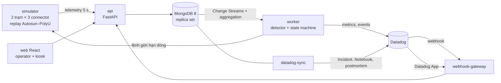

# Hồ sơ dự thi — ChargeOps

MUGVN Mini Hackathon 2026 (MongoDB × Datadog). Cập nhật 28/10/2026. Tài liệu này gom mọi hạng mục nộp bài theo thể lệ và trỏ tới nơi chứa bằng chứng trong repo. Số liệu dưới đây lấy từ MongoDB/Datadog thật hoặc từ bản đánh giá offline đã khóa; mỗi số ghi rõ nguồn.

## 0. Đối chiếu hạng mục nộp

| Hạng mục theo thể lệ | Nơi chứa | Trạng thái |
|---|---|---|
| Tên dự án, mô tả bài toán | §1 | Có |
| Thông tin đội, người liên hệ | §2 (điền ở form nộp bài) | Trưởng đội điền |
| Giải pháp và kiến trúc ứng dụng | §3 | Có |
| Kiến trúc dữ liệu, data model MongoDB | [DATA_MODEL.md](DATA_MODEL.md) | Có |
| Kiến trúc quan sát Datadog | [OBSERVABILITY.md §0](OBSERVABILITY.md) | Có |
| Repo, hướng dẫn setup | [README.md](../README.md), [KIEM_TRA.md](KIEM_TRA.md) | Có |
| README: môi trường, triển khai, cấu hình, kiểm thử | [README.md](../README.md), [ENVIRONMENT.md](ENVIRONMENT.md) | Có |
| MVP chạy được | Docker Compose local; Datadog chỉ trong thời hạn trial | Có |
| Mô tả kịch bản sự cố | §4 | Có |
| Video demo, slide chung kết | Kịch bản: [DEMO_SCRIPT.md](DEMO_SCRIPT.md); link: §7 | Chưa quay/dựng |
| Khai báo thành phần tái sử dụng, dataset, AI | [DISCLOSURE.md](DISCLOSURE.md), [DATA_CARD.md](DATA_CARD.md) | Có |
| Quyền đọc repo private cho tài khoản giám khảo | GitHub, sau khi BTC gửi tài khoản | Trưởng đội làm |

## 1. Dự án và bài toán

**ChargeOps: cảnh báo sớm quá nhiệt connector trạm sạc xe điện, xử lý có kiểm chứng.**

Connector và cáp sạc nóng lên theo bình phương dòng điện. Khi tiếp xúc kém, đầu nối bẩn hoặc lão hóa, connector nóng hơn mức đáng có ở cùng tải. Trạm sạc thường chỉ có ngưỡng nhiệt cố định, nên gặp hai lỗi ngược nhau:

- **Báo muộn:** ở tải thấp, connector lỗi vẫn dưới ngưỡng cho tới khi trip, phiên sạc bị gián đoạn.
- **Báo nhầm:** ở tải cao hoặc trời nóng, connector khỏe chạm ngưỡng, bị giảm tải oan, khách mất điện năng.

Ngoài ra, xác nhận cảnh báo hay gửi lệnh giảm tải không chứng minh sự cố đã được xử lý; cần dữ liệu cho thấy dòng thực sự giảm và nhiệt thực sự hồi phục.

## 2. Đội và liên hệ

Thông tin cá nhân (họ tên, email, người liên hệ, trưởng đội) không lưu trong repo; trưởng đội điền ở form nộp bài của BTC.

## 3. Giải pháp và kiến trúc ứng dụng

1. **Phát hiện theo residual vật lý.** Worker tính nhiệt kỳ vọng từ nhiệt môi trường, dòng sạc (k·I²) và quán tính nhiệt, rồi lấy residual = nhiệt đo − nhiệt kỳ vọng. Báo động khi residual trung bình của cửa sổ 60 giây hợp lệ > 8 °C, phục hồi khi < 3 °C. Cửa sổ thiếu mẫu, có lỗ hổng hoặc dữ liệu cũ bị chặn, không báo và cũng không tính phục hồi.
2. **Hai đường phát hiện, một vòng xử lý.** Mode `local`: detector của worker mở sự cố. Mode `datadog`: worker gửi metric lên Datadog, composite monitor (residual và chất lượng cửa sổ) gọi webhook vào ChargeOps.
3. **Phản ứng có cổng kiểm soát.** Vòng đời `open → acknowledged → mitigating → mitigated → verifying → resolved`. Giảm tải đặt giới hạn tuyệt đối `min(50% giới hạn gốc, 50% dòng tham chiếu)`. Chỉ chuyển `mitigated` khi telemetry sau lệnh chứng minh dòng ≤110% mục tiêu và residual hồi phục; chỉ `resolved` sau 120 giây retest ở tải ≥90% dòng tham chiếu. Lệnh gửi từ web hoặc từ Datadog App đều đi qua cùng cổng trạng thái của worker.
4. **Điều tra và hậu kiểm.** Dashboard, log và trace nối với nhau theo `run_id`/`connector_id`/`trace_id`; mỗi sự cố của run Datadog có Datadog Incident, todo cho từng bước và Notebook điều tra; khi đóng, MongoDB tính postmortem và đẩy lên Datadog.

| Service (Compose) | Vai trò |
|---|---|
| `mongo` | MongoDB 8.0.5, replica set một node (cần cho Change Streams) |
| `api` | REST `/api/v1`, đăng nhập operator, nhận telemetry/webhook/lệnh |
| `worker` | Writer duy nhất của trạng thái sự cố: cửa sổ, detector, vòng đời, kiểm chứng giảm tải, metric Datadog |
| `simulator` | Replay đường tải 50 phiên Autosun–PolyU v3, mô hình nhiệt, lỗi có seed, áp dụng lệnh |
| `web` | Giao diện tiếng Việt: tổng quan fleet, chi tiết connector, sự cố, trạm (operator và màn hình người lái), demo, đánh giá |
| `datadog`, `webhook-gateway`, `tunnel`, `datadog-sync` | Profile `observability`: Agent, cổng 3 route, quick tunnel, đồng bộ Incidents/Notebooks |

## 4. Kịch bản sự cố: phát hiện → điều tra → phản ứng → phục hồi

Kịch bản `thermal_fault`: theo seed, một connector đang sạc ổn định bị lỗi tiếp xúc ở giây 120–300 của run, nóng thêm 9,5–11 °C so với nhiệt kỳ vọng ở cùng tải. Các connector còn lại khỏe. Detector không đọc seed hay ground truth.

| Giai đoạn | Điều xảy ra | Bằng chứng |
|---|---|---|
| Phát hiện | Residual cửa sổ vượt 8 °C trong khi nhiệt tuyệt đối vẫn có thể dưới ngưỡng cố định; composite monitor gọi webhook; ChargeOps mở đúng một sự cố `source=datadog` | Datadog monitor, `inbox`, `incidents.evidence` |
| Điều tra | Dashboard kỹ sư: residual có vạch 8/3 °C và event phủ lên, nhiệt đo so với kỳ vọng, dòng và giới hạn dòng, nhiệt môi trường; log theo `run_id` có `trace_id` mở sang APM; Notebook điều tra tự sinh | Dashboard `wm9-b8d-raw`, Notebook, Logs, APM |
| Phản ứng | Operator xác nhận, giảm tải về `target_current_a`, worker kiểm chứng dòng thực tế giảm và residual hồi phục, rồi bảo trì | `commands`, timeline, `evidence_before/after` |
| Phục hồi | Kiểm tra 120 giây ở tải gần như ban đầu, residual từng mẫu < 3 °C, sự cố `resolved`; postmortem tính bằng `$merge`, Datadog Incident resolved | `incident_reports`, Datadog Incident |

**Vòng trọn vẹn trên MongoDB và Datadog thật**, run `39207f81…`, ngày 20/10/2026, một connector, operator tự động `chargeops.demo` (dữ liệu từ `incidents`/`incident_reports`):

| Thời điểm (từ đầu run) | Sự kiện |
|---|---|
| t+425 s | Webhook từ composite monitor, sự cố mở; residual cửa sổ 9,66 °C |
| t+434 s | Xác nhận |
| t+449 s | Giảm tải: giới hạn gốc 200 A, dòng tham chiếu 60 A → mục tiêu 30 A |
| t+521 s | Dòng thực tế giảm đã được xác minh (96 s sau khi mở) |
| t+612 s | `mitigated`: residual cửa sổ 2,99 °C |
| t+623 s | Bảo trì đã áp dụng |
| t+776 s | `resolved` sau retest 120 giây (350 s sau khi mở) |

Webhook `Recovered` của Datadog đến ở t+720 s chỉ được ghi nhận, không tự đóng sự cố. Sự cố này là Datadog Incident #2 với 11 todo (10 bước và postmortem).

**Trên code hiện tại**, run `5e2bd546…` ngày 28/10/2026 (`thermal_fault`, seed 42): composite monitor mở sự cố `source=datadog` trên `connector-1` ở t+480 s (residual 9,74 °C); không có operator xử lý nên run dừng ở t+1800 s, sự cố đóng với `closed_by: run_stopped` và Datadog Incident #6 được resolve. Một vòng trọn vẹn trên code hiện tại sẽ được quay trong video demo ([DEMO_SCRIPT.md](DEMO_SCRIPT.md)).

## 5. Kết quả và tác động

Đánh giá offline `b1-eval-v3.1` (`data/evaluation/b1-eval-v3.1/summary.json`): protocol, ngưỡng và seed khóa lúc 21/10/2026 08:21 UTC trước khi chạy; 20 seed lỗi và 20 seed khỏe × 3 nhánh = 120 lượt mô phỏng; công bố cả kết quả không đạt.

- **A:** ngưỡng nhiệt cố định 74 °C và can thiệp.
- **B:** detector residual nhưng không can thiệp (đối chứng).
- **C:** ChargeOps đầy đủ.

| Chỉ số | A | B | C |
|---|---|---|---|
| Phát hiện trước trip (20 seed lỗi) | 8/20 | 20/20 | **20/20** |
| Báo trước khi lỗi bắt đầu (seed lỗi) | 2 | 0 | **0** |
| Báo động giả / connector-giờ (seed khỏe) | 0,9 | 0 | **0** |
| Trip (seed lỗi) | 0 | 14 (7 seed) | **1** |
| Phút sạc bị gián đoạn (seed lỗi) | 0 | 59,75 | **4,9** |
| Thời gian tới giảm tải có tác dụng, trung vị | 135 s | — | 135 s |
| Sự cố `resolved` (seed lỗi) | 1 | 0 | **13** |
| Điện năng giao trên seed khỏe so với B | −40,6 kWh | 0 | **0** |
| Điện năng giao trên seed lỗi so với B | +5,9 kWh | 0 | −22,5 kWh |

Đọc kết quả:

- So với ngưỡng cố định, residual phát hiện đủ 20/20 lỗi và không giảm tải oan connector khỏe (A mất 40,6 kWh trên seed khỏe vì báo nhầm).
- So với chỉ phát hiện mà không xử lý, ChargeOps giảm trip từ 14 xuống 1 và phút gián đoạn từ 59,75 xuống 4,9. Đổi lại, connector lỗi bị giảm tải nên giao ít hơn 22,5 kWh; đó là chi phí có chủ đích của việc giữ an toàn.
- Mục tiêu khóa trước: C phát hiện ≥18/20 trước trip, ≤1 lượt khỏe có sự cố, không lệnh trùng. Cả ba đều đạt.

**Giới hạn:** đây là kết quả mô phỏng. Đường tải lấy từ dataset công khai, còn nhiệt độ, lỗi và phản ứng sau lệnh do simulator tạo; không suy ra hiệu quả trên trạm thật hay chuẩn an toàn thiết bị. Bản đánh giá khóa ngày 21/10, trước khi thêm lớp realism (nhiệt môi trường theo ngày, mất/trùng/trễ mẫu) ngày 27/10.

## 6. Công nghệ bắt buộc

| Yêu cầu | Đáp ứng |
|---|---|
| MongoDB là nền tảng dữ liệu vận hành chính | Toàn bộ trạng thái nằm trong MongoDB ([DATA_MODEL.md §1, §3](DATA_MODEL.md)) |
| Data model hợp lý, truy cập hiệu quả | Index theo đường truy cập, unique partial index, idempotency ([DATA_MODEL.md §3, §5](DATA_MODEL.md)) |
| Aggregation Pipeline gắn với bài toán | Cửa sổ residual, latest state, xu hướng, MTTA/MTTM/MTTR, postmortem ([DATA_MODEL.md §4](DATA_MODEL.md)) |
| MongoDB khuyến khích | Time Series, `expireAfterSeconds`, `$setWindowFields`, Change Streams, xử lý theo sự kiện |
| Datadog: dashboard | 2 dashboard: kỹ sư điện và IT/SRE |
| Datadog: monitor gắn với lỗi có ý nghĩa | Composite thermal + quality gọi webhook; stale, worker heartbeat, derating kẹt |
| Datadog: tính năng bổ sung | Log Management, APM, RUM, Incidents, Notebooks, SLO, App Builder |
| Metrics, logs, traces, bối cảnh nối với nhau | Tag chung, `trace_id` trong log, RUM → APM, event sự cố trên dashboard ([OBSERVABILITY.md §0](OBSERVABILITY.md)) |

## 7. Demo, video, slide

- MVP: chạy theo [README.md](../README.md) hoặc [KIEM_TRA.md](KIEM_TRA.md).
- Video demo: `<link sau khi tải lên>`
- Slide chung kết: `<link sau khi dựng>`
- Kịch bản quay và dàn ý slide: [DEMO_SCRIPT.md](DEMO_SCRIPT.md).
- Trial Datadog hết hạn khoảng 29/10/2026, trước vòng sơ khảo. Phần Datadog được chứng minh bằng video, ảnh chụp trong `artifacts/` và định nghĩa tài nguyên do `scripts/setup_datadog.py` sinh.

## 8. Khai báo

- Dataset: Autosun–Hong Kong Polytechnic v3, DOI `10.17632/c7gg94tmvz.3`, CC BY 4.0; chỉ dùng đường tải ([DATA_CARD.md](DATA_CARD.md)). Không dùng dữ liệu cá nhân, mật hoặc dữ liệu vận hành thật.
- Thành phần mã nguồn mở và license: [DISCLOSURE.md](DISCLOSURE.md).
- AI: Codex (chuẩn bị) và Claude Code (build); phạm vi và mốc thời gian theo Git ở [DISCLOSURE.md](DISCLOSURE.md).
- Phần viết trước 17/10 được khai báo riêng ở [DISCLOSURE.md](DISCLOSURE.md).
